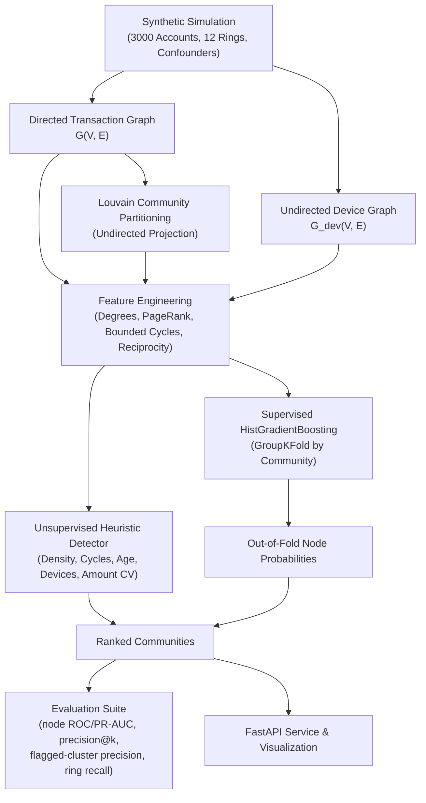
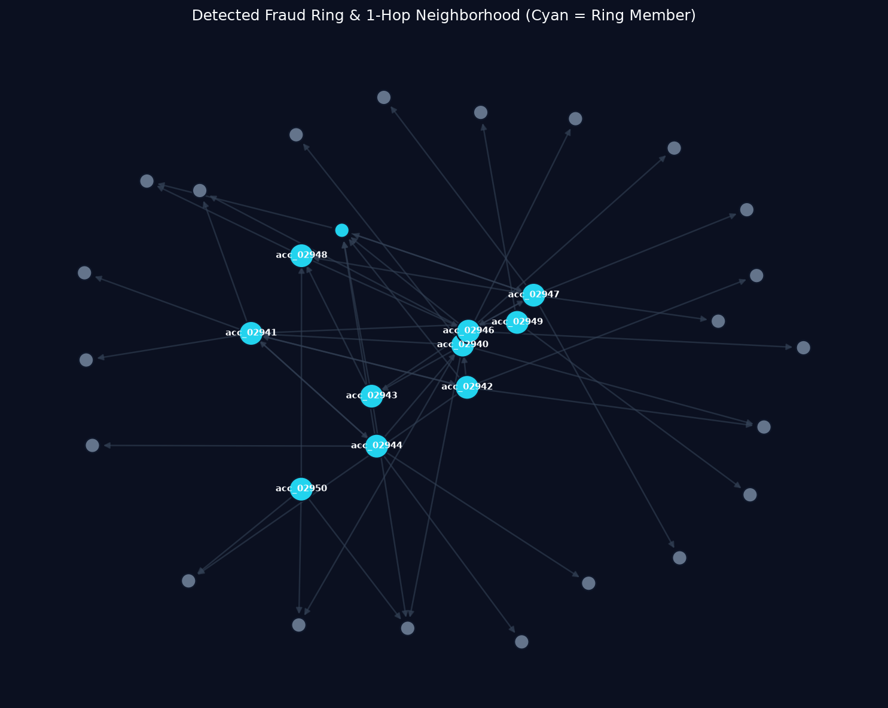
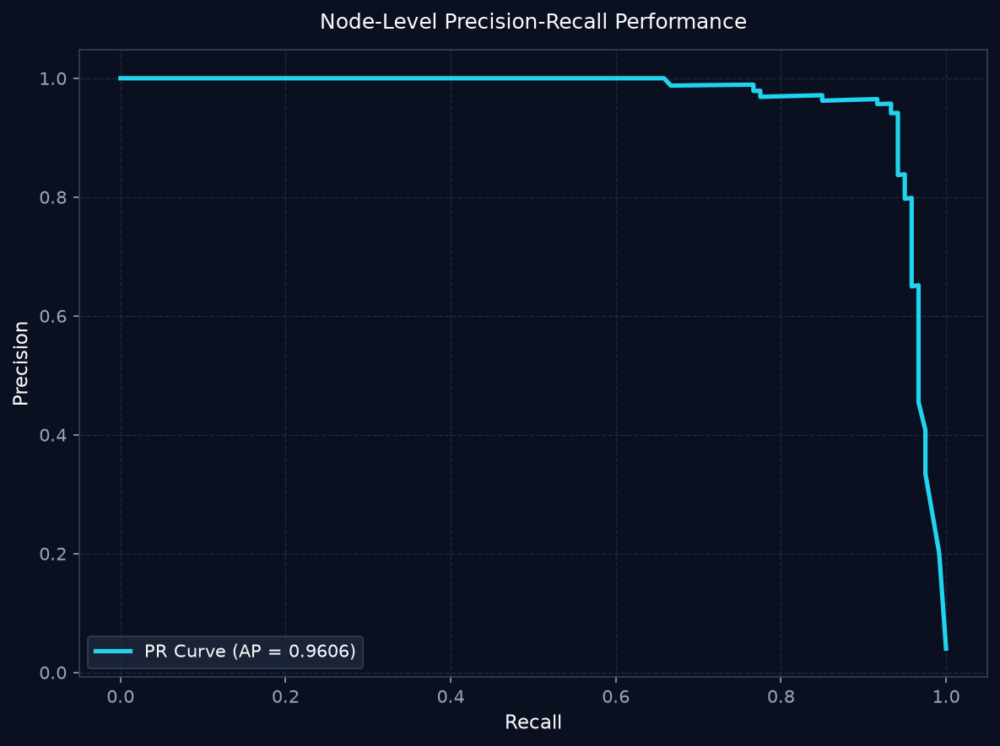

# Graph-Based Fraud Ring Detection

[](https://github.com/pulok529/graph_fraud_ring_detection/actions/workflows/ci.yml)


A pipeline and REST service for detecting coordinated financial fraud rings in transaction networks. Combines graph topology algorithms, device sharing footprints, unsupervised heuristic community ranking, and supervised gradient-boosted trees evaluated with strict community cross-validation.



---

## Results

3,000 simulated accounts, 12 rings (pipeline: `python -m fraud_rings.pipeline --accounts 3000 --rings 12`). Node scores are out-of-fold (GroupKFold by community).

| Metric | Value |
|---|---|
| Node ROC-AUC | 0.992 |
| Node PR-AUC | 0.961 |
| Node precision@k (k = number of true ring members) | 0.942 |
| Flagged-cluster precision (top 10 clusters, hit = at least 50% ring members) | 1.000 |
| Ring recall (rings with at least half their members inside a flagged cluster) | 0.750 |

**Reading the numbers.**
- **Core members are easy:** they sit in dense cycles of similar amounts, which is a strong structural signature, so account-level scores are high.
- **Rings are harder:** 3 of 12 rings are missed at the cluster level. Their members are aged "mule" accounts, use their own devices, or have only one or two edges, so not enough of the ring gets flagged together.
- **No easy shortcut:** the simulation adds families and roommates who also share devices and transact densely, and ring members also shop at merchants, so no single feature gives the answer away.

<p align="center">
  
  
</p>


---

## Simulated Fraud Patterns and Confounders

To rigorously benchmark detection mechanisms without proprietary customer data, the simulation engine generates a financial ecosystem reflecting real-world topologies:

- **Legitimate Ecosystem**:
  - **Preferential Attachment Sinks**: Merchants and payment processors represent high in-degree hubs receiving diffuse payments from broad customer demographics.
  - **Peer-to-Peer Transfers**: Random pairwise transactions across established accounts with log-normal value distributions.
- **Fraud Rings**:
  - **Coordinated Topologies**: Rings consist of 5 to 15 accounts created recently within the transaction window.
  - **Directed Circular Routing**: Tight directed cycles ($A \to B \to C \to A$ or $A \to B \to C \to D \to A$) and reciprocal edges designed to inflate apparent transaction volume or obfuscate fund origin.
  - **Near-Equal Amounts**: Rapid succession transfers executed with uniform values (coefficient of variation $< 0.05$).
  - **Device Clustering**: Fraudsters share a small pool of common devices (1 to 3 devices per ring).
  - **Cash-Out Edge Extraction**: Outgoing exit edges diverting funds to external merchants or money mules.
- **Realistic Confounders**:
  - **Benign Multi-User Hardware (Families / Roommates)**: Legitimate clusters that share single device IDs and transact with high internal frequency. Crucially, they exhibit older account histories, diverse transfer amounts (high coefficient of variation), and no artificial cycles of uniform funds.
  - **Peripheral Ring Members**: Stealth ring nodes with only 1 or 2 interactions that evade simple high-degree filters.

---

## Feature Engineering

Each account node is mapped into a vector capturing local topology, flow balance, and community context:

| Feature Category | Features | Description |
| :--- | :--- | :--- |
| **Flow & Centrality** | `in_degree`, `out_degree` | Total count of distinct incoming and outgoing payment partners. |
| | `weighted_in_amount`, `weighted_out_amount` | Cumulative monetary volume routed in and out. |
| | `pagerank` | Structural centrality identifying network-level transaction hubs. |
| **Topology & Density** | `clustering` | Local clustering coefficient on the undirected graph projection. |
| | `k_core` | Maximal subgraph core number representing relational cohesiveness. |
| | `cycle_count` | Number of simple directed cycles (lengths 2, 3, and 4) passing through the node, computed via bounded successor-predecessor set intersections. |
| | `reciprocity` | Ratio of mutually reciprocated payment channels to total node degree. |
| **Profile & Entity Footprint** | `account_age` | Elapsed calendar days since registration (new accounts pose higher baseline risk). |
| | `kyc_level` | Verification tier (1 to 3) assigned during customer due diligence. |
| | `shared_device_count` | Degree within the device-sharing graph, indicating hardware reuse. |
| | `amount_similarity` | Coefficient of variation ($\sigma / \mu$) across outgoing transfer values. |
| **Community Structure** | `community_size` | Number of accounts in the node's Louvain modularity community. |
| | `community_density` | Directed internal edge density of the containing Louvain partition. |

---

## Detection Approaches

### 1. Unsupervised Heuristic Community Detector
Partitions the undirected projection into modular communities using the Louvain algorithm (`seed=42`). For each community $C$, a composite risk score is evaluated:

$$\text{Score}(C) = \left( w_1 \cdot \text{Density} + w_2 \cdot \text{CycleRatio} + w_3 \cdot \text{AgeRisk} + w_4 \cdot \text{DeviceFootprint} + w_5 \cdot \text{AmountSimilarity} \right) \times \text{SizeMultiplier}$$

- **Cycle Ratio**: Cumulative directed cycles normalized by community size.
- **Age Risk**: Penalizes clusters dominated by recently registered accounts.
- **Amount Similarity**: Exponential penalty on amount variation ($\exp(-2 \cdot \text{CV})$), highlighting uniform circular flow.
- **Size Multiplier**: Suppresses trivial 1- or 2-node components.

### 2. Supervised HistGradientBoosting Classifier
Trains a `HistGradientBoostingClassifier` with native histogram binning and balanced class weighting over all tabular node features.

#### Why GroupKFold by Community?
Standard random K-Fold cross-validation suffers severe data leakage in graph learning: nodes belonging to the same fraud ring share identical device footprints and reciprocal edges. If part of a ring is placed in training and another in validation, the model memorizes community-specific artifacts rather than learning generalized structural fraud patterns.

By grouping strictly on `community_id`, entire topological clusters are held out. Folds evaluate the model's ability to discover previously unseen fraud rings in isolated network partitions. Out-of-fold predictions are aggregated to community-level probabilities by computing the mean risk across members.

### 3. From flagged accounts to candidate rings
Louvain communities on the full graph are dominated by popular merchants, so each ring ends up inside a much larger community. Investigators need a short list instead. The pipeline takes the subgraph of accounts with an out-of-fold probability of at least 0.5, splits it into connected components, keeps those with at least 3 accounts, and ranks them by mean probability. These **flagged clusters** feed `top_communities.csv`, the `/communities/top` endpoint and the ring metrics.

---

## How to Run

### Local Setup
Ensure Python 3.10+ is installed:

```bash
# 1. Clone repository
git clone https://github.com/pulok529/graph_fraud_ring_detection.git
cd graph_fraud_ring_detection

# 2. Set up virtual environment
python -m venv .venv
source .venv/bin/activate  # On Windows: .venv\Scripts\activate

# 3. Install development dependencies
pip install -r requirements-dev.txt
pip install -e .

# 4. Run full test suite and linters
ruff check .
pytest -v

# 5. Execute detection pipeline
python -m fraud_rings.pipeline --accounts 3000 --rings 12 --out artifacts/
```

### Docker
```bash
# Build production image
docker build -t fraud-rings:latest .

# Run containerized service
docker run -d --name fraud-api -p 8000:8000 fraud-rings:latest

# Check health endpoint
curl -s http://localhost:8000/health
```

---

## API Examples

### Health Check
```bash
curl -X GET http://localhost:8000/health
```
```json
{
  "status": "ok"
}
```

### Top Suspicious Communities
```bash
curl -X GET "http://localhost:8000/communities/top?limit=2"
```

*(Example response from a real run)*:
```json
[
  {
    "community_id": 0,
    "rank": 1,
    "score": 0.9997,
    "size": 10,
    "member_ids": [
      "acc_02940",
      "acc_02941",
      "acc_02942",
      "acc_02943",
      "..."
    ],
    "heuristic_signals": {
      "mean_cycle_count": 2.1,
      "mean_account_age": 25.8,
      "mean_device_sharing": 0.6,
      "mean_amount_cv": 0.6009,
      "mean_reciprocity": 0.1683
    }
  }
]
```

### Account Risk Profile
```bash
curl -X GET http://localhost:8000/accounts/acc_02910/risk
```

*(Example response from a real run)*:
```json
{
  "account_id": "acc_02940",
  "node_probability": 1.0,
  "community_id": 0,
  "community_score": 0.9997,
  "top_signals": {
    "cycle_count": 2,
    "shared_device_count": 0,
    "amount_similarity": 0.2239,
    "reciprocity": 0.0,
    "account_age": 3
  }
}
```

---

## Repository Structure

```
graph_fraud_ring_detection/
├── .github/
│   └── workflows/
│       └── ci.yml               # GitHub Actions CI matrix (Py 3.11/3.12, ruff, pytest, docker)
├── api/
│   ├── __init__.py
│   └── main.py                  # FastAPI service factory, lifespans, and risk endpoints
├── docs/
│   └── top_ring.png             # Ring visualization asset
├── notebooks/
│   └── 01_fraud_ring_walkthrough.ipynb  # Interactive walkthrough in nbformat 4
├── src/
│   └── fraud_rings/
│       ├── __init__.py          # Package version export
│       ├── simulate.py          # Synthetic generator with hubs and confounders
│       ├── graph.py             # DiGraph and device footprint constructors
│       ├── features.py          # Topological, flow, and Louvain feature extractors
│       ├── detect.py            # Heuristic scorer and GroupKFold HistGradientBoosting
│       ├── evaluate.py          # Node and community retrieval metrics
│       ├── visualize.py         # Matplotlib Agg publication network renderer
│       └── pipeline.py          # CLI driver and artifact generator
├── tests/
│   ├── __init__.py
│   ├── test_simulate.py         # Validates ring rates, cycle presence, ID uniqueness
│   ├── test_features.py         # Validates complete rows, zero NaNs, triangle cycles
│   ├── test_pipeline.py         # End-to-end integration test with ROC-AUC validation
│   └── test_api.py              # TestClient tests for health, retrieval, and 404s
├── .dockerignore
├── .gitignore
├── Dockerfile                   # Non-root multi-stage image with precomputed artifacts
├── LICENSE                      # MIT License
├── Makefile                     # Developer commands (lint, test, pipeline, docker)
├── pyproject.toml               # Package configuration, ruff rules, pytest paths
├── README.md
├── requirements-dev.txt         # Development and testing toolchain
└── requirements.txt             # Runtime production dependencies
```

---

## Limitations

- **Bounded Cycle Depth**: Cycle extraction is capped at length $\le 4$ and bounded per node to ensure execution within seconds on standard CPUs. Complex rings executing high-order cycles ($\ge 6$ hops) across diffuse intermediate accounts are not captured by local cycle features.
- **Static Graph Projection**: The current implementation aggregates multi-day transactions into cumulative edge amounts, discarding granular millisecond timestamp ordering.
- **Modularity Resolution Limits**: Louvain community detection can merge small fraud rings into larger adjacent legitimate structures if interconnecting edges are present.

---

## Roadmap

- [ ] **Graph Neural Networks (GraphSAGE / RGCN)**: Implement relational inductive GNN architectures directly over heterogeneous node and edge types (accounts, cards, devices, IP subnets).
- [ ] **Temporal Dynamic Graph Modeling**: Incorporate continuous-time dynamic graph embeddings (e.g., TGN / DyGFormer) to capture burst velocity and rapid balance-draining sequences.
- [ ] **Streaming Feature Aggregations**: Transition graph feature state extraction to online incremental streaming engines (e.g., Apache Flink or Kafka Streams).
